# Libaraxia

A self-hosted library catalogue for the books you own, the ones you've read and the ones you want. Built with Flask and SQLite, it keeps your reading life on your own server, away from the prying eyes of corporations and AI.

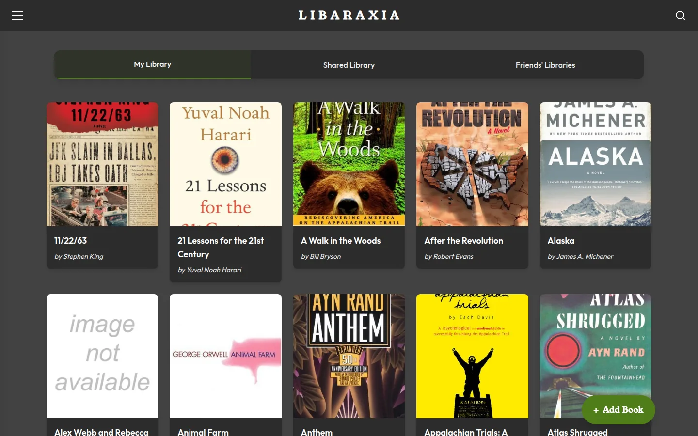

What started as a hobby project is now a full personal library manager: scan or search to add books, track what you're reading, rate and review, keep a wishlist, and share a household library with the people you live with.

## Screenshots

| | |
|---|---|
| 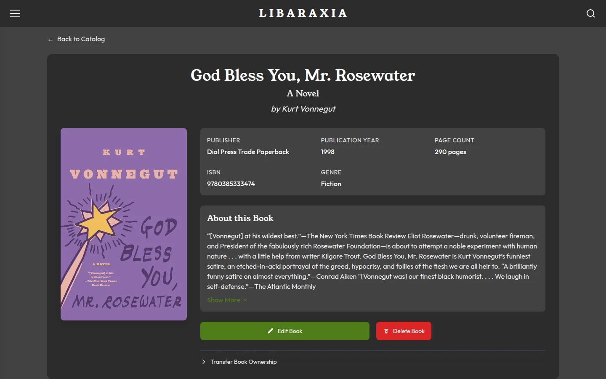 **Book detail.** Metadata, description, edit and transfer. | 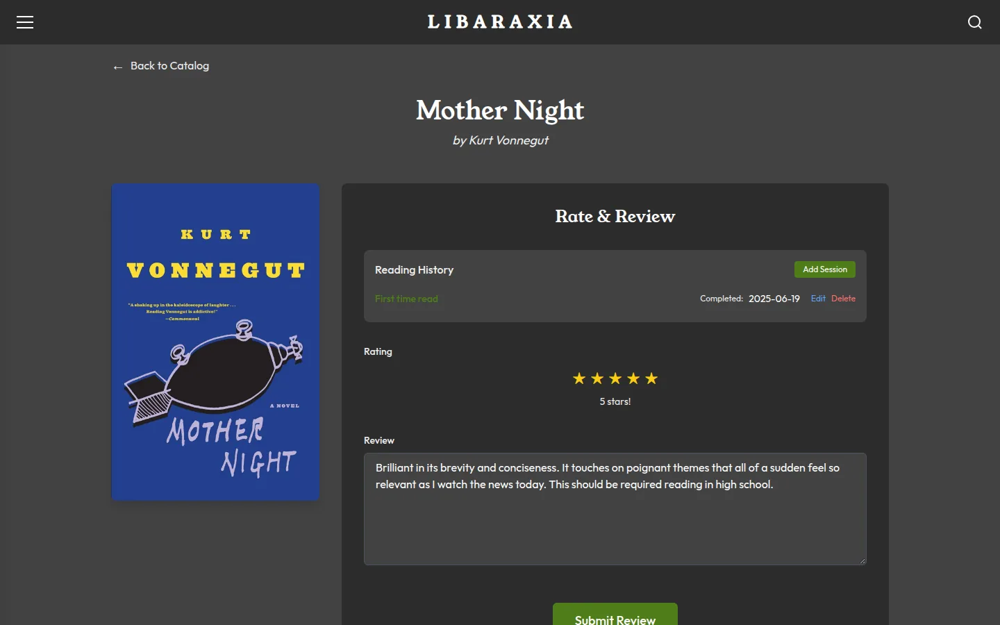 **Rate & review.** Star rating, review and reading sessions. |
| 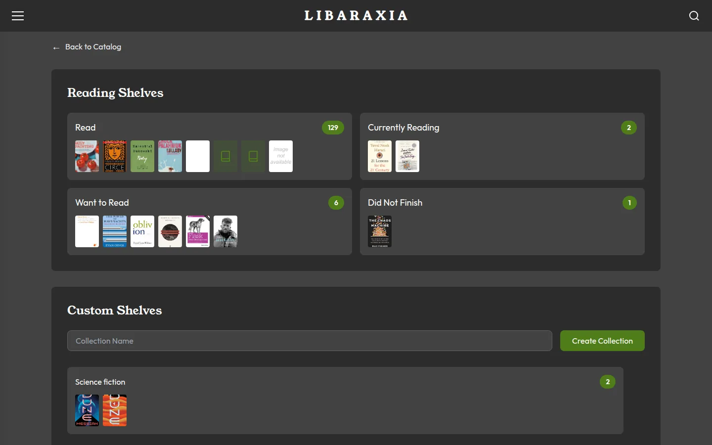 **Shelves.** Reading status plus your own custom collections. | 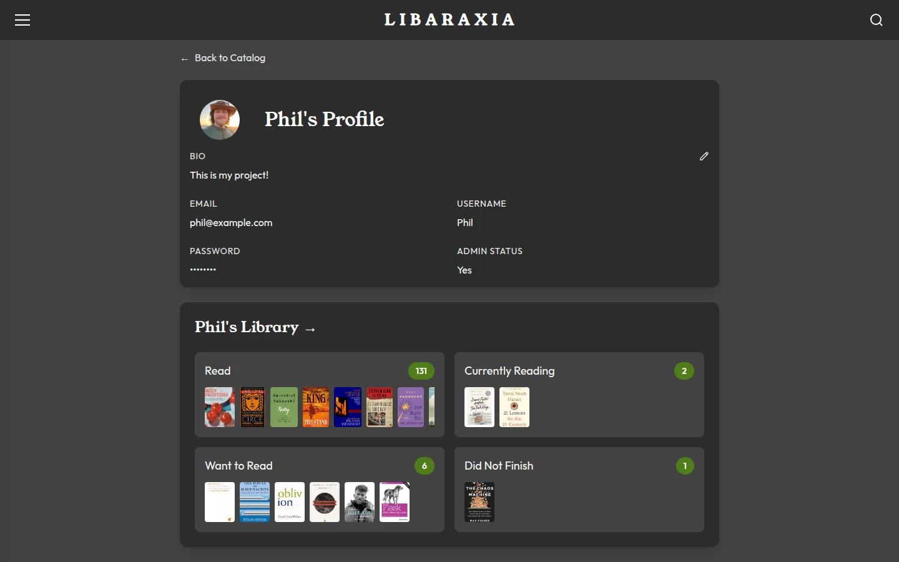 **Profile.** Bio, settings and your shelves at a glance. |
| 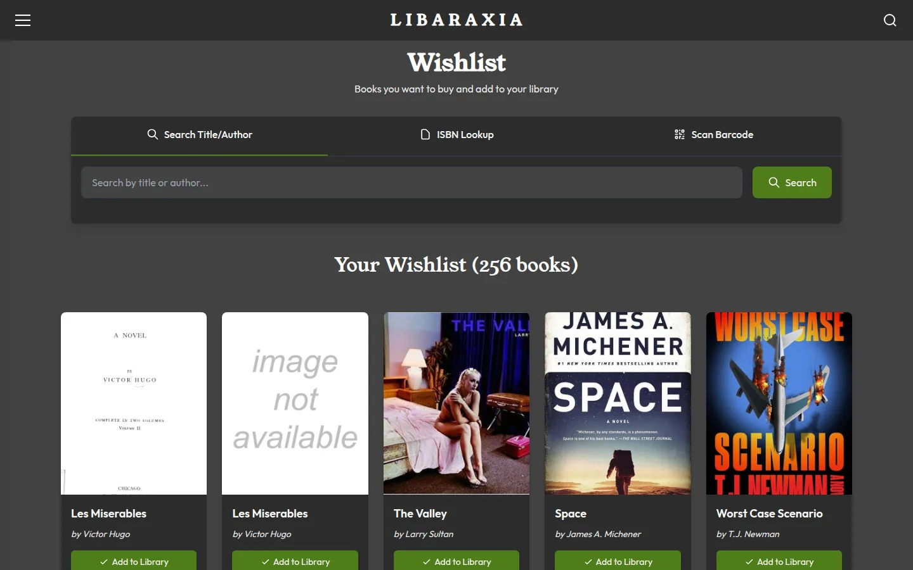 **Wishlist.** Search, ISBN or barcode; move to library when bought. | 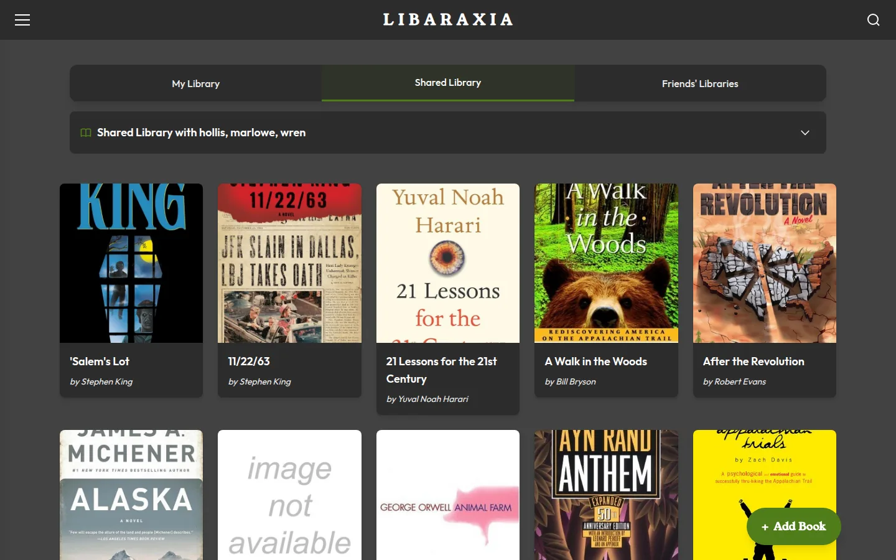 **Shared library.** One catalogue for the whole household. |
| 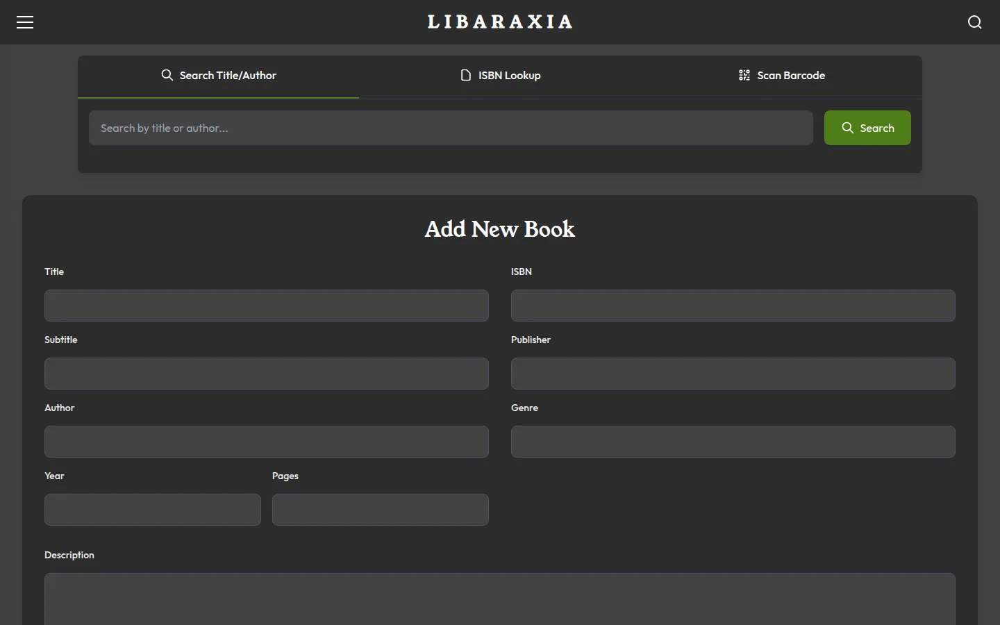 **Add a book.** Title/author search, ISBN lookup or camera barcode scan. | 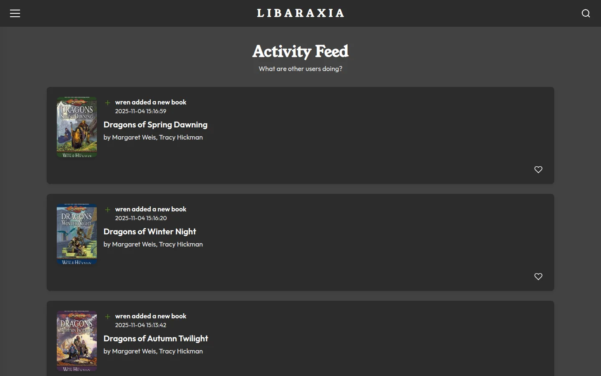 **Activity feed.** What your friends are adding and reading. |

<p>
  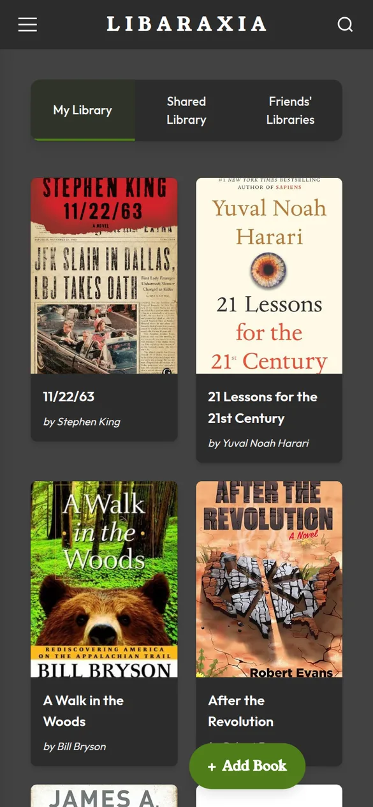
  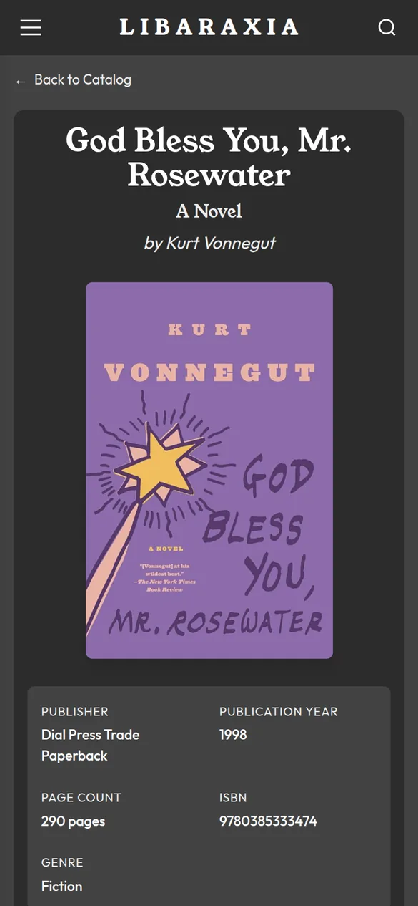
</p>

## ✨ Features

**Cataloguing**
- Add books by title/author search, ISBN lookup or camera barcode scan (Google Books and Open Library)
- Automatic cover download, or upload your own; bulk cover fetch for books missing one
- Edit, delete and transfer books; duplicate detection when adding
- Library grid with search, sort, filters and infinite scroll
- Per-user tags and custom collections
- CSV export, and **Goodreads CSV import** for any user

**Reading**
- Reading status: read, currently reading, want to read, did not finish
- Star ratings and reviews
- Reading sessions with start/finish dates, so re-reads are tracked
- Reading stats on your profile

**People**
- Multi-user with login, remember-me and optional email verification
- Friends: requests, notifications, and browsing friends' libraries, wishlists and reviews
- Household **shared library**: members see one combined catalogue
- Activity feed with likes
- Admin panel: users, avatars, orphaned image cleanup, household membership

**Security**
- CSRF protection on every form and API call, bcrypt passwords, rate limiting on auth and imports
- Hardened image handling (uploads confined to `static/uploads/`, SSRF-guarded cover downloads)
- Self-registration can be closed after the first (admin) account

## 🛠️ Installation

Libaraxia is a hobby project under active development. It runs my own library every day, but expect rough edges. Production runs under **gunicorn directly**; the Docker files are kept for reference and aren't currently maintained.

**Requirements:** Python 3.11+, `sqlite3`, and Node.js only if you want to rebuild the CSS.

### 1. Get the code and install dependencies

```shell
git clone https://github.com/philcifone/libaraxia
cd libaraxia
python3 -m venv venv && source venv/bin/activate
pip install -r requirements.txt
```

### 2. Configure

```shell
cp .env.example .env
python3 -c "import secrets; print(secrets.token_hex(32))"   # paste into SECRET_KEY
```

Edit `.env`:

| Variable | What it does |
|---|---|
| `SECRET_KEY` | **Required.** Session signing key. Use the random value above. |
| `GOOGLE_BOOKS_API_KEY` | Book lookups. Get one at [console.cloud.google.com](https://console.cloud.google.com). |
| `FLASK_ENV` | `development` or `production`. Production makes cookies `Secure`, so it needs HTTPS. |
| `ALLOW_REGISTRATION` | Set to `False` once your accounts exist, so strangers can't sign up. |
| `TRUSTED_PROXY_COUNT` | Set to `1` if you run behind nginx/Caddy, so rate limits see real client IPs. |
| `EMAIL_VERIFICATION_REQUIRED`, `MAIL_*` | Optional email verification. |

> **Note:** every setting can go in `.env` or be a real environment variable (e.g. in a systemd unit); a real environment variable wins. The database defaults to `library.db` in the project directory, and the app logs which file it opened at startup.

### 3. Create the database

```shell
python3 manage.py migrate
```

This builds `library.db` from `create_database.sql`. Later, after `git pull`, the same command backs up the database and applies any new migrations. `python3 manage.py status` shows where you are. See [`migrations/README.md`](migrations/README.md).

**Upgrading an install from before `manage.py` existed:** run `python3 manage.py migrate --baseline` once, then `python3 manage.py migrate`.

### 4. Run

```shell
python3 app.py                                      # development server on :5000
gunicorn -w 4 -b 0.0.0.0:5000 'app:create_app()'    # production
```

Open `http://localhost:5000`. With no users yet, you're sent to registration, and **the first account becomes the admin**.

**Barcode scanning on a phone** needs HTTPS. For local testing, run `./generate-cert.sh`, then `python3 app.py --cert certs/cert.pem --key certs/key.pem`. See [docs/HTTPS-SETUP.md](docs/HTTPS-SETUP.md).

### Rebuilding the CSS

The compiled Tailwind file `static/css/output.css` is committed. Rebuild it only if you change templates or `static/styles.css`:

```shell
npm install
npm run build:css     # or: npm run watch:css
```

## 🗺️ Roadmap

Planned work, in order, is in **[ROADMAP.md](ROADMAP.md)**. In short: a design refresh to match [philcifone.com](https://philcifone.com) and [negativeearth.net](https://negativeearth.net) (Gruvbox light and dark, Courier Prime + Young Serif, square corners; same UI, new skin) first, then production hardening and data-integrity fixes, finishing the Goodreads import, a page-layout refactor and design polish, and VHS/UPC barcode support.

The original dev diary and to-do list are in [docs/DEVLOG.md](docs/DEVLOG.md).

## 💡 Contributing

Found a bug? Have a feature idea? Contributions are welcome! This started as a personal project, and I'm not a trained developer. A lot of it was built in collaboration with AI, and I'd love for experienced human eyes to look it over. **Please** feel free to:

- Open issues for bugs or feature requests
- Submit pull requests
- Share ideas and feedback
- Help with documentation

Developer notes (architecture, conventions, security rules) are in [CLAUDE.md](CLAUDE.md).

## Status

A personal project, built for my own household's books. It's public so others can read and learn from it. It's provided as-is under the GPL-3.0, with no support, stability or upgrade path promised. Fork it freely; you run your own copy at your own risk.

## License

[GPL-3.0](LICENSE). Bundled third-party files keep their own licenses: fonts under the SIL Open Font License (`static/fonts/*/OFL.txt`), Bootstrap Icons and Quagga under MIT (see `static/vendor/README.md`).

---
Built with ☕ and 🥃 by a 📖 lover, for 📚 lovers.
